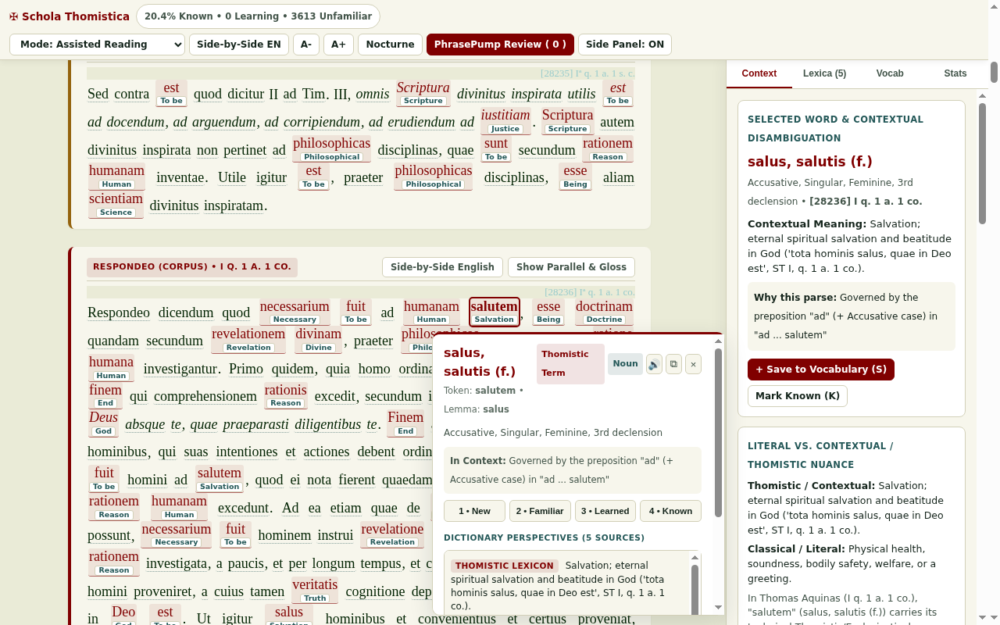
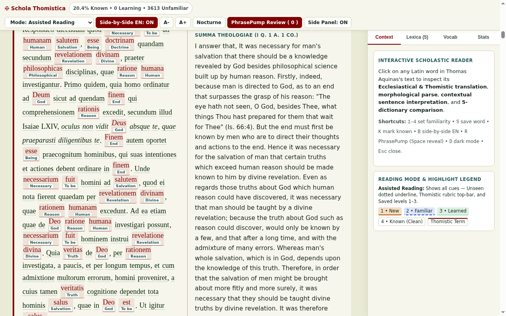

# ✠ Schola Thomistica — Interactive Latin Reader, 5-Dictionary Engine & PhrasePump FSRS Platform for Corpus Thomisticum

[](./LICENSE)
[](./src/extension/manifest.json)
[](./tests)
[-94630E.svg)](./QA_AUDIT_AND_FEATURES.md)

**Schola Thomistica** is an open-source Manifest V3 browser extension and complete offline archive that transforms [**Corpus Thomisticum**](https://www.corpusthomisticum.org/)—the complete Latin *Opera Omnia* of St. Thomas Aquinas edited by Roberto Busa SJ and Enrique Alarcón—into an interactive, extensive-reading Latin acquisition environment inspired by **LingQ**, **Language Reactor (PhrasePump)**, and **Anki (FSRS)**, purpose-built for **Ecclesiastical and Scholastic Latin**.





---

## Table of Contents

1. [What is Schola Thomistica, How It Works & Feature Overview](#1-what-is-schola-thomistica-how-it-works--feature-overview)
2. [Browser Installation Guide (Step-by-Step: Essential vs. Complete Edition)](#2-browser-installation-guide-step-by-step-essential-vs-complete-edition)
   - [Option A: Essential Edition (Dictionaries, Grammar & Custom Notes Only — Lightweight)](#option-a-essential-edition-dictionaries-grammar--custom-notes-only--lightweight)
   - [Option B: Complete Edition (Full Platform — 5 Dictionaries + 80,695 Parallel Translations + Offline Archive)](#option-b-complete-edition-full-platform--5-dictionaries--80695-parallel-translations--offline-archive)
3. [AI-Assisted Engineering Methodology & Development Trajectory](#3-ai-assisted-engineering-methodology--development-trajectory)
4. [Repository Structure & Verification Commands](#4-repository-structure--verification-commands)
5. [License, Privacy & Third-Party Notices](#5-license-privacy--third-party-notices)

---

## 1. What is Schola Thomistica, How It Works & Feature Overview

### What is Schola Thomistica?

Reading St. Thomas Aquinas in the original Latin is often hindered by two barriers: generic Classical Latin tools misinterpret Medieval/Scholastic vocabulary and syntax (treating *actus*, *potentia*, *habitus*, *species*, *intentio*, or *sacramentum* merely in their Classical senses), and switching back and forth between external dictionaries, grammar tables, and English translations breaks reading flow.

**Schola Thomistica** embeds a complete philological and pedagogical studio directly into every page of Corpus Thomisticum—both on the **live website (`https://www.corpusthomisticum.org/*`)** and on the **included 1,217-file offline archive (`http://127.0.0.1:8765/*`)**.

### How It Works Under the Hood

1. **Non-Destructive Off-Tree DOM Tokenizer (`src/extension/reader-controller.ts`):**
   - Scans Latin `<P>` paragraphs at `document_end`, preserving original `<SPAN CLASS="ref">` Bekker/Busa citation numbers (`[28236]`) and `<A NAME="...">` anchors while wrapping every Latin word in an interactive `<span class="ct-word">` with zero character-offset drift (`data-char-offset`).
   - Uses a `MAIN`-world script (`neutralize-perseus.js`) to disable Corpus Thomisticum's legacy double-click popup to `perseus.tufts.edu` so word clicks are handled instantaneously inside the page.
2. **Medieval & Scholastic Latin Normalizer (`src/core/normalizer.ts`):**
   - Normalizes medieval orthography (`ci ↔ ti` as in *condicio/conditio*, `ae/oe/e`, `j/i`, `v/u`, *quatuor/quattuor*, *michi/mihi*, *charitas/caritas*), decomposes Scholastic fused compounds (*inquantum*, *intantum*, *idest*, *seipso*, *huiusmodi*, *quemadmodum*, *quodammodo*), and strips true enclitics (`-que`, `-ne`, `-ve`, `-cum`, `-met`) while protecting Scholastic `-ive` adverbs (*abstractive*, *speculative*), 3rd-declension `-ne` ablatives (*ratione*, *homine*, *ordine*), and lexicalized `-que` connectives (*denique*, *quousque*, *quandoque*, *uterque*).
3. **Deterministic Morphological Engine (`src/core/morphology.ts`):**
   - Indexes **38,088 Whitaker's Words entries** and **1,797 inflection rules** (`DICTLINE.GEN`, `INFLECTS.LAT`, `UNIQUES.LAT`, `ADDONS.LAT`), handling syncopated perfects (*quaesieris → quaesiveris*), `-er` consonant-stem adjectives (*noster*, *sacer*, *pulcher*, *miser*), 3rd-declension `-is` adjectives (*naturalis*, *formalis*, *possibilis*), and compound pronominal declensions (*uterque, utraque, utrumque*).
4. **Context-Aware Scholastic Sentence Disambiguator (`src/core/context-analyzer.ts`):**
   - Extracts the exact sentence containing the clicked word occurrence (without breaking on Roman numeral citations like `Eccli. III.` or `VI Metaphys.`) and scores candidate morphological parses using surrounding governing prepositions (`ad`, `in`, `de`, `ex`, `ab`, `cum`, `per`, `praeter`, `propter`, `secundum`), determiner agreement (`huius doctrinae` → Genitive Singular), and subordinate clause triggers (`videtur quod`, `ut`, `ne`, `cum`, `licet`, `utrum`).

### Core Features

- **5 Integrated Dictionaries on Every Word Click (`#st-popup` & `Lexica (5)` Tab):**
  1. **Thomistic Lexicon (*Thomas-Lexikon*)** — `1,950` technical Scholastic & Thomistic headwords parsed from Ludwig Schütz's *Thomas-Lexikon* + curated English philosophical/theological explanations, Aquinas usage quotes, and Scholastic axioms.
  2. **Ecclesiastical Latin Dictionary** — `20,154` Church, Liturgical, Biblical (*Vulgata*), Patristic, and Medieval Latin entries with explicit Classical vs. Ecclesiastical contrasts.
  3. **Wiktionary (Latin-English & Victionarium)** — `23,006` bundled entries + optional live REST API enrichment (`en.wiktionary.org`) with one-click privacy opt-out.
  4. **Lewis & Short (*A Latin Dictionary*)** — `22,637` Classical & Late Latin entries from the Perseus Project edition.
  5. **Whitaker's Words** — `38,088` lexical stems and full morphological parse listings.
- **Lemma-Linked Custom Word Definitions & Personal Study Notes (`+ Custom Definition / Note`):**
  - Write your own **Custom Definition** and **Personal Study Note** (philosophical commentary, cross-references, or grammar reminders) for any word.
  - Linked automatically to the word's **lemma** across the entire Corpus Thomisticum: your custom definition appears in a highlighted **`My Definition & Note`** card at the top of `#st-popup` and in the `Context` / `Lexica (5)` / `Vocab` tabs, updates the **inline mini-glosses (`data-gloss`)** beneath all occurrences of that lemma on the page, powers your **PhrasePump** review prompts, and exports dedicated `CustomDefinition` and `Notes` columns to **Anki TSV**.
- **Smart Scroll-Anchored & Viewport-Flipping Popup:**
  - Follows the selected word smoothly during page scroll and automatically flips **above** the word (`data-placement="above"`) when near the bottom of the screen so the word and rating buttons are never covered.
  - Includes Ecclesiastical Latin pronunciation (`🔊` TTS + phonetic guide `[sa-lu-tem]`), one-click clipboard copy (`⧉`), and top familiarity rating bar (`1 • New`, `2 • Familiar`, `3 • Learned`, `4 • Known`).
- **Side-by-Side Bilingual Reading Mode (`80,695` Verified Sections — `82.3%` of Complete Opera Omnia) & Interlinear Gloss Drawer:**
  - Toggle **`Side-by-Side EN`** (or press `B`) to split paragraphs into two parallel columns (**Latin on the left**, **aligned English translation on the right**) while keeping the expandable **Word-by-Word Interlinear Gloss Drawer** underneath.
  - Covers **80,695 verified sections** (`73,971 / 89,917` reachable `<P TITLE>` paragraphs across `868` *Opera Omnia* files = **82.3% of the entire Corpus Thomisticum**), verified with a strict bidirectional vocabulary overlap gate (`overlap >= 0.70` and `reverse_overlap >= 0.65`):
    - *Summa Theologiae* (**99.8%**), *Summa Contra Gentiles* (**99.7%**), *Scriptum super Sententiis* (**86.5%**).
    - *Quaestiones Disputatae*: *De Veritate* (**94.8%**), *De Potentia* (**98.9%**), *De Spiritualibus Creaturis* (**100%**), *De Anima* (**95.0%**), *De Unione Verbi Incarnati* (**96.9%**), *De Virtutibus* (**81.9%**), *Quodlibeta I–XII* (`1,308` sections).
    - *Aristotelian & Philosophical Commentaries*: *Metaphysics* (**99.6%**), *Ethics* (**99.5%**), *De Anima* (**99.9%**), *De Caelo* (**99.3%**), *De Generatione* (**100%**), *Physics* (**97.7%**), *Posterior Analytics* (**97.5%**), *Peryermeneias* (**99.1%**), *De Sensu* (**95.6%**), *Super Boetium De Trinitate* (**99.3%**).
    - *Biblical Commentaries & Catena Aurea*: *Catena Aurea* on Matthew/Mark/Luke/John (**99.9%**), *Super Ioannem* (**100%**), *Super Iob* (**100%**), *Super Psalmos* (**99.4%**), *In Jeremiam* (**99.5%**), *Pauline Epistles* (**98.5%–100%**).
    - *Opuscula & Catechetical Works*: *Compendium Theologiae* (**100%**), *De Ente et Essentia* (**100%**), *De Principiis Naturae* (**100%**), *De Substantiis Separatis* (**100%**), *De Regno* (**100%**), *De Aeternitate Mundi* (**100%**), *De Unitate Intellectus* (**100%**), *Contra Impugnantes* (**98.2%**), *Contra Errores Graecorum* (**100%**), *Credo* (**100%**), *Pater Noster* (**100%**).
- **3 Progressive Reading Modes:**
  - `Mode: Assisted Reading`: Inline interlinear mini-glosses (`[Salvation]`, `[Being]`, `[Doctrine]`) beneath core Thomistic terms and saved learning words, unseen word underlines, and open Side Panel.
  - `Mode: Guided Scholastic`: Hides inline mini-glosses and unseen underlines; highlights only core Thomistic philosophical/theological terms and saved vocabulary (`1–3`).
  - `Mode: Independent Reader`: Distraction-free book mode; auto-collapses the Side Panel and removes all Thomistic and learned (`2–3`) highlights.
- **PhrasePump + Anki FSRS v4.5/v5 Spaced Repetition Studio:**
  - Full mathematical **FSRS v4.5/v5** scheduler (`1 • Again`, `2 • Hard`, `3 • Good`, `4 • Easy`) with 5 selectable practice modes (`Mixed`, `Sentence Cloze`, `Latin → English`, `English → Latin`, `Scholastic Grammar`), plus **Anki TSV** and **JSON** export.

---

## 2. Browser Installation Guide (Step-by-Step: Essential vs. Complete Edition)

You can install **Schola Thomistica** in **Google Chrome**, **Brave**, **Microsoft Edge**, or **Chromium** in two ways depending on whether you want a lightweight dictionary-only extension or the complete bilingual platform with all 80,695 parallel English translations.

---

### Option A: Essential Edition (Dictionaries, Grammar & Custom Notes Only — Lightweight)

Choose **Option A** if you only want the browser extension with the **5 Latin dictionaries**, **contextual morphological & grammar analysis**, **custom word definitions & personal study notes**, **word-by-word interlinear glosses**, and **PhrasePump FSRS vocabulary review** on `https://www.corpusthomisticum.org/`—**without** downloading the 65 MB parallel English translations of Aquinas's works (`~24 MB` unpacked / `~5 MB` zip).

#### A1. Download from GitHub Releases (Fastest — No Build Required)
1. Go to the [**Releases**](../../releases) page of this repository and download **`schola-thomistica-essential-edition.zip`**.
2. Extract `schola-thomistica-essential-edition.zip` to a folder on your computer.
3. Open your browser and navigate to the Extensions page:
   - **Chrome / Chromium:** `chrome://extensions/`
   - **Brave:** `brave://extensions/`
   - **Edge:** `edge://extensions/`
4. Turn **ON** the **Developer mode** (*Modo do desenvolvedor*) toggle in the top-right corner.
5. Click **Load unpacked** (*Carregar sem compactação*) in the top-left corner and select the extracted folder.
6. Visit [https://www.corpusthomisticum.org/sth1001.html](https://www.corpusthomisticum.org/sth1001.html) — **Schola Thomistica** activates automatically!

#### A2. Or Build the Essential Edition from Source
```bash
git clone https://github.com/ApenasUmPecador/schola-thomistica.git
cd schola-thomistica
npm install
npm run build:lite
```
Then in `chrome://extensions/` (with **Developer mode** enabled), click **Load unpacked** and select:
```text
schola-thomistica/dist/extension-lite
```

---

### Option B: Complete Edition (Full Platform — 5 Dictionaries + 80,695 Parallel Translations + Offline Archive)

Choose **Option B** if you want the **complete experience** used in this project: all **5 Latin dictionaries**, **custom word definitions & notes**, **PhrasePump FSRS**, **AND** all **80,695 parallel English translation sections** (`Summa Theologiae`, `Scriptum super Sententiis`, `Summa Contra Gentiles`, `Quaestiones Disputatae`, Aristotelian & Biblical Commentaries, `Catena Aurea`, and `Opuscula`) for **Side-by-Side Bilingual Reading (`Side-by-Side EN`)**, plus the **complete 1,217-file offline archive** of Corpus Thomisticum.

#### B1. Download Complete Extension from GitHub Releases
1. Go to the [**Releases**](../../releases) page of this repository and download **`schola-thomistica-complete-edition.zip`**.
2. Extract `schola-thomistica-complete-edition.zip` to a folder on your computer.
3. Open `chrome://extensions/` (or `brave://extensions/` / `edge://extensions/`), enable **Developer mode**, click **Load unpacked**, and select the extracted folder.
4. Visit [https://www.corpusthomisticum.org/sth1001.html](https://www.corpusthomisticum.org/sth1001.html) (or `oee.html`, `qdv01.html`, `snp1001.html`, `scg1001.html`) and click **`Side-by-Side EN`** (or press `B`) to read Latin and English side by side!

#### B2. Build Complete Edition & Run the Full Offline Archive Locally
```bash
git clone https://github.com/ApenasUmPecador/schola-thomistica.git
cd schola-thomistica
npm install
npm run build
```
1. **Load the Complete Extension in Your Browser:**
   - Open `chrome://extensions/`, enable **Developer mode**, click **Load unpacked**, and select:
     ```text
     schola-thomistica/dist/extension
     ```
2. **Browse the Complete 1,217-File Offline Archive (100% Offline, Pre-Injected):**
   ```bash
   npm run serve
   # Starts multi-threaded local server at http://127.0.0.1:8765/
   ```
   Open [http://127.0.0.1:8765/sth1001.html](http://127.0.0.1:8765/sth1001.html) or [http://127.0.0.1:8765/iopera.html](http://127.0.0.1:8765/iopera.html) in any browser.

---

## 3. AI-Assisted Engineering Methodology & Development Trajectory

This software was engineered end-to-end through an adversarial, test-driven, multi-agent AI software engineering workflow:

| Role | System / Model / Plugin |
|---|---|
| **Agentic Coding Harness** | **OpenCode** |
| **Primary AI Engineering Agent** | **Gemini 4 Argon** (`opencode-go/gemini-4-argon`) |
| **Multi-Model QA & Visual Beta-Tester Subagents** | **GPT-6 Luna**, **DeepSeek V4.1 1017 Flash**, **GLM 5.3-Flash**, and **GLM 5.3** |
| **Independent Software Quality Auditor** | **Claude Code** ([`AUDIT_REPORT_2026-11-11.md`](./AUDIT_REPORT_2026-11-11.md) & [`AUDIT_REPORT_2026-11-12.md`](./AUDIT_REPORT_2026-11-12.md)) |
| **Skills & Agentic Plugins** | **Everything Claude Code (ECC)** & **Superpowers** (`brainstorming`, `writing-plans`, `executing-plans`, `test-driven-development`, `systematic-debugging`, `receiving-code-review`, `verification-before-completion`, `continuous-learning-v2`, `growth-log`, `living-docs-governance`, `test-collaboration`, `opensource-pipeline`, `github-ops`) |

---

### Chronological Engineering Trajectory (From Initial Prompt to Final Subagent Validation)

#### Phase 1: Initial Mission Prompt — Full Website Archival & Core Latin-Learning Platform
- **User Prompt:** Download and archive the entire website `https://www.corpusthomisticum.org/`, then build an interactive browser extension inspired by Language Reactor, LingQ, and Anki so a reader can click any Latin word in Thomas Aquinas's works to see its English translation, morphological parse, and contextual meaning within the sentence, save unfamiliar words, and practice them via spaced repetition (`continuous-learning-v2` enabled).
- **What Was Built:**
  - Engineered a polite, resumable crawler (`scripts/archive-site.py`) that archived **1,217 files (111.72 MiB)** of Corpus Thomisticum (`868` *Opera Omnia* texts, `24` *Thomas-Lexikon* files, `27` navigation/subsidia pages, `5` stylesheets, `293` icons) with relative link rewriting and `archive/manifest-archive.json`.
  - Built the data compiler (`scripts/build-dictionaries.py`) and core TypeScript engine (`src/core/normalizer.ts`, `morphology.ts`, `dictionaries.ts`, `context-analyzer.ts`, `sentence-translator.ts`, `fsrs.ts`, `vocabulary-store.ts`, `stats-tracker.ts`).
  - **First Critical Technical Discovery (`ISO-8859-1` Charset Corruption):** Corpus Thomisticum serves HTML with `charset=ISO-8859-1`. Raw UTF-8 characters inside regex literals in content scripts were misinterpreted by the browser as `À-ÿ`, throwing `SyntaxError: Range out of order in character class`. Replaced all non-ASCII regex characters with `\uXXXX` escapes, enforced `charset: 'ascii'` in `esbuild`, and pinned a permanent E2E test verifying `dist/extension/content.js` is 100% 7-bit ASCII.

#### Phase 2: Smart Scroll-Following & Viewport-Flipping Popup + 5-Dictionary Expansion
- **User Prompts:**
  1. Fix `#st-popup` remaining static on scroll and covering the clicked word / clipping rating buttons when near the bottom of the screen.
  2. Eliminate placeholder strings (`"Latin term in Corpus Thomisticum"`) in the interlinear gloss.
  3. Expand the popup dictionary comparison to **5 distinct dictionaries** (`Thomistic Lexicon`, `Ecclesiastical Latin Dictionary`, `Wiktionary`, `Lewis & Short`, and `Whitaker's Words`).
- **What Was Built:**
  - Implemented `positionPopup()` with passive `scroll`/`resize` listeners and live DOM height measurement (`getBoundingClientRect().height`), automatically flipping the popup **above** the word (`data-placement="above"`) when space below is insufficient.
  - Integrated all 5 dictionaries (`38,088` Whitaker entries, `1,950` *Thomas-Lexikon* entries, `20,154` Ecclesiastical Latin entries, `23,006` Wiktionary/Victionarium entries, and `22,637` reconstructed Lewis & Short entries) directly inside `#st-popup` and the `Lexica (5)` tab.

#### Phase 3: Adversarial Multi-Model Browser QA Loop (`GLM 5.3`, `GLM 5.3-Flash`, `GPT-6 Luna`, `DeepSeek V4.1 1017 Flash`), Side-by-Side Bilingual Mode & Live Website Parity
- **User Prompts:**
  1. Dispatch independent subagents from different model families driving a real browser (`agent-browser`) as beta testers to critique the UI/UX, using vision-capable models (`GLM 5.3-Flash`, `GPT-6 Luna`, `DeepSeek V4.1 1017 Flash`) to inspect rendered screenshots.
  2. Add a 2-column **Side-by-Side English translation mode** (Latin on the left, English reference translation on the right) while keeping the expandable Interlinear Gloss drawer underneath.
  3. Clarify and visually differentiate the **3 Progressive Reading Modes** (`Assisted Reading`, `Guided Scholastic`, `Independent Reader`), fix stem collisions (`sum` vs. `sumo`), and make the extension work identically on the live internet site (`https://www.corpusthomisticum.org/*`).
- **What Was Built & Fixed:**
  - Across 3 rounds of multi-model browser QA, fixed `Space` key scrolling in PhrasePump (`[C1]`), scoped Nocturne dark-mode CSS selectors (`[C2]`), restricted hotkeys `1–4` to open popups (`[C3]`), added `🔊` Ecclesiastical TTS + phonetic guide / `⧉` copy / `×` close buttons, and implemented tri-state per-paragraph Side-by-Side toggles.
  - Added inline interlinear mini-glosses (`data-gloss` + `::after`) for `Assisted Reading` mode, eliminated raw truncated Whitaker stem keys (`s1/s2`) that caused `sumo` (`"sum"`) to collide with `sum, esse`, enforced a strict bidirectional content-word overlap gate (`overlap >= 0.70` & `reverse_overlap >= 0.65`), and added `MAIN`-world `neutralize-perseus.js` for live `https://www.corpusthomisticum.org/*` parity.

#### Phase 4: Independent Software Quality Audits by `Claude Code` & Full TDD Remediation (`DEF-001`–`DEF-019` & `NEW-001`–`NEW-006`)
- **User Prompts:** Read the two independent software quality audit reports generated by **Claude Code** ([`AUDIT_REPORT_2026-11-11.md`](./AUDIT_REPORT_2026-11-11.md) and [`AUDIT_REPORT_2026-11-12.md`](./AUDIT_REPORT_2026-11-12.md)), understand every reported defect, and resolve them one by one using strict Test-Driven Development.
- **What Was Fixed & Verified:**
  - **`DEF-001` & `DEF-002` (Critical/High — Cross-Surface Storage Sync & Study Center Persistence):** Replaced "hydrate only if empty" with `VocabularyStore.mergeSnapshot()` and `StatsTracker.mergeSnapshot()` uniting entries by `id`/lemma and `updatedAt`, preserving `reviewHistory` and `knownLemmas`, listening to `chrome.storage.onChanged`, and persisting every review in `study.ts`.
  - **`DEF-003`, `NEW-001` & `NEW-003` (High — Bundle Size, TTI & Split Lazy Loading):** Externalized `src/data/*.json` into `dist/extension/data/*.json` via `src/core/data-loader.ts`, separating lexical dictionary loading (`ensureLexicalDataLoaded`) from parallel corpus loading (`ensureParallelCorpusLoaded`) and running `rehydratePageLemmasAndCoverage()` after hydration.
    - Shrunk `dist/extension/content.js` from **51.1 MB to 174.0 KB** (**293x smaller**).
    - Reduced real Chromium `DOMContentLoaded` on arm64 Raspberry Pi from **5,066 ms to 227 ms** (**22x faster**) and initial JS heap from **124.5 MB to 3.5 MB**.
    - Achieved **0% lemma drift** between `.ct-word[data-lemma]` and `analyzeWord(word).primaryLemma`.
  - **`DEF-004`, `DEF-005`, `DEF-006`, `DEF-007`, `NEW-002` (Linguistic & Offset Precision):** Added `uterque` declension + Whitaker tackons, unified citation stripping and non-`.ref` tokenization (**0 offset drift** across 24,539 tokens on `snp1001`–`snp4001`), protected `denique`/`quousque`/`quandoque` from enclitic stripping, fixed `-ndam` gerundive detection (`ad ostendendam veritatem`) while excluding `ad secundum`, and fixed `-er` consonant-stem adjectives (`noster`, `sacer`, `pulcher`, `miser`).
  - **`DEF-008`–`DEF-019`, `NEW-004`–`NEW-006` & Chrome Web Store Readiness:** Removed per-word `tabindex="0"` (`4,543 → 0` tabbable words), added `#st-skip-link`, `role="dialog"`, `aria-modal`, `aria-live="polite"`, `:focus-visible`, and `prefers-reduced-motion`; scoped `manifest.json` permissions and `neutralize-perseus.js`; added `PRIVACY_POLICY.md`, `LICENSE`, `THIRD_PARTY_NOTICES.md`, extension icons (`16/48/128`), and `tsc --noEmit` in `npm test`.

#### Phase 5: Lemma-Linked Custom Word Definitions & Personal Study Notes, Subagent Browser Validation & Corpus-Wide `isidore.co/aquinas` Expansion (`80,695` Sections)
- **User Prompts:**
  1. Add a feature allowing users to write their own **custom definition** and **personal annotations/notes** linked to a word's **lemma** across the entire corpus (using Superpowers `brainstorming` → `writing-plans` → `executing-plans`).
  2. Dispatch a browser QA subagent to test the new feature end-to-end and fix every bug found.
  3. Integrate missing English translations across Corpus Thomisticum works from [`https://isidore.co/aquinas`](https://isidore.co/aquinas).
- **What Was Built & Verified:**
  - Implemented `customDefinition` and `notes` per lemma in `VocabularyStore`, `PhrasePump`, `#st-popup` (`#st-popup-note-editor` + `My Definition & Note` top card), `Context`, `Lexica (5)`, `Vocab`, and `Anki TSV`.
  - Dispatched a QA subagent driving real Chromium (`npx agent-browser`), which tested the feature across works and identified 11 UI/edge-case findings (popup vertical overflow when editing near viewport center, `Context`/`Lexica` tab display, `mergeSnapshot` empty-string clearing, `Enter`/`Escape` key bindings in inputs, and DOM reset on `Remove`), all 11 of which were fixed and re-verified as `PASS` in a second browser QA pass.
  - Downloaded all **276 bilingual HTML files (83.92 MiB)** from `Geremia/AquinasOperaOmnia` (`isidore.co/aquinas`) + `Geremia23/AquinasLatinEnglish` and aligned them across all `868` *Opera Omnia* files in `archive/`, expanding `summa-english.json` from `53,224` to **`80,695` verified sections (`82.3%` of all paragraphs in the entire Corpus Thomisticum)**.

For the complete prompt-by-prompt engineering ledger, Delete-Zone rules, and QA checklists, see:
- [**`DEVELOPMENT_LOG.md`**](./DEVELOPMENT_LOG.md) — Chronological Prompt Ledger, Root-Cause Analyses & Handoff Guide
- [**`QA_AUDIT_AND_FEATURES.md`**](./QA_AUDIT_AND_FEATURES.md) — Feature Specification, Test Registry (`TEST-ID`s) & 10-Point Beta-Tester Checklist
- [**`AUDIT_REPORT_2026-11-11.md`**](./AUDIT_REPORT_2026-11-11.md) & [**`AUDIT_REPORT_2026-11-12.md`**](./AUDIT_REPORT_2026-11-12.md) — Independent Software Quality Audits (`Claude Code`)
- [**`CHANGELOG.md`**](./CHANGELOG.md) — Release History (`v1.0.0` → `v1.2.0`)

---

## 4. Repository Structure & Verification Commands

```text
schola-thomistica/
├── archive/                  # Complete 1,217-file offline mirror of www.corpusthomisticum.org
├── dist/
│   ├── extension/            # Complete Edition MV3 unpacked extension (Dictionaries + 80,695 Translations)
│   └── extension-lite/       # Essential Edition MV3 unpacked extension (Dictionaries Only)
├── docs/superpowers/         # Design specs and implementation plans
├── scripts/
│   ├── archive-site.py       # Polite, resumable crawler for www.corpusthomisticum.org
│   ├── build-dictionaries.py # Compiles 5 dictionaries + 80,695 parallel English sections
│   ├── build-extension.mjs   # Bundles Complete & Essential MV3 extensions via esbuild
│   └── serve-archive.py      # Multi-threaded local server (http://127.0.0.1:8765/)
├── src/
│   ├── core/                 # Normalizer, Morphology, 5 Dictionaries, Context Analyzer, FSRS, Vocab Store
│   ├── data/                 # Compiled lexical & parallel translation JSON datasets
│   └── extension/            # MV3 Reader Controller, Popup, Study Center, Background Service Worker & CSS
├── store-assets/             # 1280x800 Chromium screenshots
└── tests/                    # 7 Vitest unit & E2E integration suites (50 automated tests)
```

```bash
npm test             # Runs tsc --noEmit + all 7 Vitest suites (50/50 unit & E2E tests)
npm run build        # Builds both Complete (dist/extension) and Essential (dist/extension-lite) editions
npm run build:lite   # Builds Essential Edition (dist/extension-lite, dictionaries only)
npm run build:data   # Rebuilds src/data/*.json from cached sources & archive/
npm run serve        # Serves the 1,217-file offline archive at http://127.0.0.1:8765/
```

---

## 5. License, Privacy & Third-Party Notices

- **Code License:** Original source code in `src/` and `scripts/` is licensed under the [**MIT License**](./LICENSE).
- **Privacy Policy:** Zero telemetry or analytics; vocabulary and notes are stored locally (`localStorage` + `chrome.storage.local`). Optional live Wiktionary REST lookups on the online site can be toggled off at any time. See [**`PRIVACY_POLICY.md`**](./PRIVACY_POLICY.md).
- **Third-Party Lexical & Translation Sources:** Attribution and licensing details for William Whitaker's Words, Ludwig Schütz's *Thomas-Lexikon*, `ecclesia-dev/latin`, Wiktionary/Victionarium (CC BY-SA 4.0), Lewis & Short via Perseus Digital Library (CC BY-SA 3.0 US), the 1920 Fathers of the English Dominican Province *Summa Theologiae* (Public Domain), and `isidore.co/aquinas` (`Geremia/AquinasOperaOmnia` & `Geremia23/AquinasLatinEnglish`) are documented in [**`THIRD_PARTY_NOTICES.md`**](./THIRD_PARTY_NOTICES.md).
